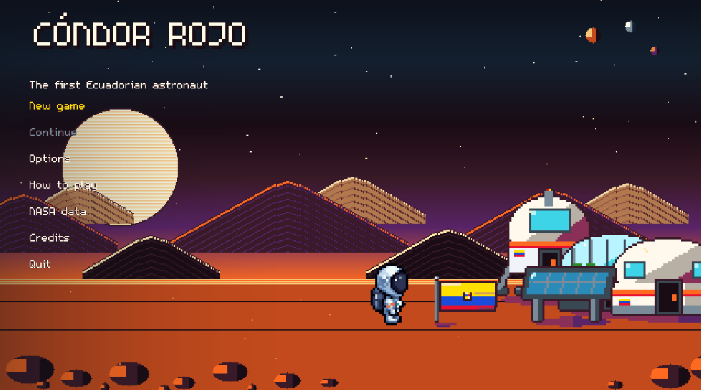

# Cóndor Rojo 🚀

**A Mars survival adventure built by Astrosharks for the NASA Space Apps Challenge 2026.**

[**Visit the Website & Play the Game**](https://jpacheco-iaa.github.io/condorRojowebsite/) | [**Launch the Game Directly**](https://jpacheco-iaa.github.io/condorRojowebsite/game/game.html)

## 🌌 About the Project

**Cóndor Rojo** is a browser-playable, 2D pixel-art survival and exploration game developed using the **Godot Engine**.

Set on Mars, the game challenges players to establish an outpost, explore the Martian surface, recover scientific knowledge from rover archives, and manage essential resources to survive.

Our project was developed for the **NASA Space Apps Challenge 2026** by **Astrosharks**, with the goal of transforming complex space exploration concepts into an engaging, accessible educational experience.

Rather than simply presenting facts about Mars, Cóndor Rojo encourages players to experience the decisions and engineering trade-offs astronauts might encounter during a real mission.

---

## 🎮 The Game

### Gameplay

Players take the role of an astronaut exploring Mars, where every decision can influence the outcome of their expedition.

**Key features include:**

- **Resource Management:** Balance oxygen, energy, and food to survive.
- **Mars Exploration:** Explore different environments, collect samples, and complete scientific objectives.
- **Rover Archives:** Recover information inspired by five NASA rover missions.
- **Solar Energy:** Experience how Martian dust and environmental conditions affect power generation.
- **Radiation Hazards:** Respond to solar events, monitor exposure, and make shelter decisions.
- **INTI Companion:** Interact with a robotic companion during your adventure.
- **Educational Missions:** Connect exploration objectives with real scientific research.
- **Bilingual Experience:** English and Spanish support.

The game uses simplified educational simulations rather than exact engineering or medical models.

### Play Online

You can play Cóndor Rojo directly through your browser without installing Godot.

**[▶ PLAY CÓNDOR ROJO](https://jpacheco-iaa.github.io/condorRojowebsite/game/game.html)**

---

## 🌐 The Website

The Cóndor Rojo website serves as the project's main presentation and access point.

It was designed to showcase the game, explain its educational purpose, introduce the development team, and demonstrate its connections to NASA research.

### Website Features

- Cinematic homepage featuring actual Mars photography.
- Gameplay screenshots and direct access to the game.
- Information about the project's mission and objectives.
- Interactive bilingual English/Spanish interface.
- Educational facts about Mars.
- Connections between gameplay mechanics and NASA research.
- Radiation and shielding information.
- Team member profiles.
- Responsive design for desktop and mobile devices.

**Website technologies:**
- HTML5
- CSS3
- JavaScript
- GitHub Pages

---

## 🔬 NASA Research & Educational Connections

Cóndor Rojo combines fictional gameplay with authentic scientific concepts informed by NASA research.

| In-Game Experience | NASA Scientific Connection |
|---|---|
| Recovering rover archives | NASA robotic exploration missions and scientific discoveries |
| Managing solar power | Martian dust and its effects on solar-powered spacecraft |
| Collecting geological samples | Mars surface investigations and ancient water environments |
| Responding to radiation events | Space weather, astronaut exposure, and radiation shielding |
| Planning expeditions | Resource limitations and engineering decisions during space missions |

### NASA Resources

Our project draws inspiration and scientific information from:

- [NASA Mars Trek](https://trek.nasa.gov/mars/) — Real Martian terrain, orbital imagery, and elevation data.
- [NASA Mars Science](https://science.nasa.gov/mars/) — Mars missions, discoveries, and educational information.
- [NASA DONKI](https://ccmc.gsfc.nasa.gov/tools/DONKI/) — Historical space-weather observations.
- [NASA Open Science Data Repository](https://osdr.nasa.gov/bio/repo/) — Space biology and astronaut health research.
- [NASA Space Radiation](https://www.nasa.gov/hrp/hazard-space-radiation/) — Radiation hazards and protection research.

NASA-informed scenarios in
